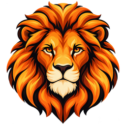

# Personal PdfCraft lion

Original artwork generated for @gh0sted5456-us using the built-in OpenAI image-generation tool,
2026-10-23. Orange and black with warm cream highlights; genuine alpha transparency, no tile.
The exact prompt is in [prompt.txt](prompt.txt). No upstream brand artwork was used as a reference.
Licensed under MIT OR Apache-2.0; see [LICENSE.txt](LICENSE.txt).

`lion-master.png` is the untouched generated master. `pdfcraft.svg` embeds that raster;
it is not traced vector artwork. `pdfcraft-small.svg` embeds a 256 px derivative. The scalable
hicolor SVG is a copy of the master wrapper. `packaging/icons.sh` renders the wrapper to the
committed hicolor PNGs, Windows ICO (nine sizes, 16–256 px) and macOS PNG/ICNS. The initial
outputs were encoded with Pillow, preserving alpha; regeneration uses the existing resvg pipeline.

The window icon, Home and About all use the lion. Windows embeds it as resource 1 and
references that resource from the PDF thumbnail TypeOverlay; Windows places the badge at
the lower-right. `pdfcraft-document.svg` and resource 2 remain the separate Lucide-based PDF
file icon, licensed in LICENSE-document.txt. App IDs and associations stay stable across upgrades.
